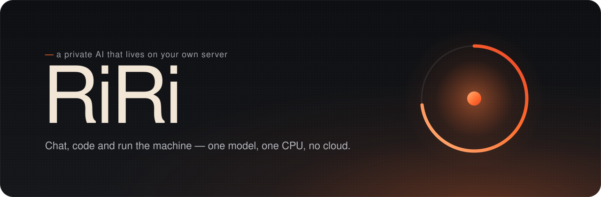
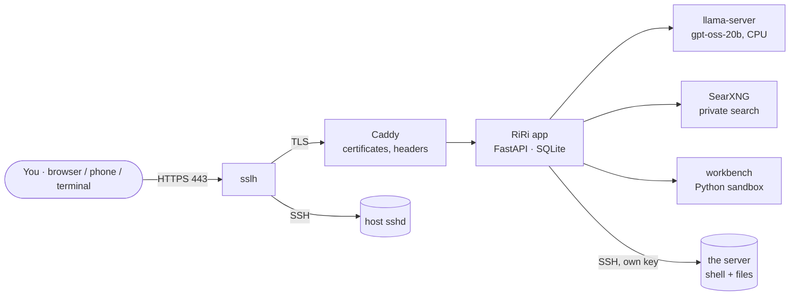

<p align="center">
  
</p>

<p align="center">
  
  
  
  
</p>

<br>

**RiRi** is a personal assistant in the spirit of JARVIS that runs entirely on hardware you own — here, a four-core
laptop with 16 GB of RAM and no GPU. She chats, remembers, searches the web, keeps your tasks and notes, pings your
phone, and does real work on the server: she runs commands, edits files and writes code, with you approving each
change. Everything — the model, the website, the search engine, your data — stays on the machine.

<br>

## &nbsp;—&nbsp; What she does

|   |   |
|---|---|
| **Talks** | A calm dark web app with your conversation history, live progress, streaming replies, Markdown and code. |
| **Works the server** | A shell and the whole file system as your user: inspect, fix, deploy, manage Docker. Changes wait for your OK (or switch a chat to *Auto*). |
| **Codes** | Point her at any folder — or a git URL — and she plans with a live checklist, edits, runs the tests and tells you what changed. |
| **Files** | Browse, edit, upload and download anything on the server from the browser. Deletes go to a trash you can restore from. |
| **Remembers** | Tasks with timed reminders, notes, long-term memories, and a morning brief written for you before you wake up. |
| **Reaches you** | Web push notifications for reminders, finished replies and approvals — installable on your phone's home screen. |
| **Browses** | Private web search through a built-in SearXNG instance, plus a page reader. |
| **Knows how** | Skills (playbooks for coding, debugging, research, writing, planning, data…) loaded only when a task needs them. |
| **Terminal too** | `riri` on the server: the same conversations in a styled terminal client. |

<br>

## &nbsp;—&nbsp; How it fits together



| Piece | Why it's there |
|---|---|
| **llama.cpp `llama-server`** | Runs the model on the CPU. One slot, prompt cache reuse, and per-conversation state saved to disk so switching chats takes seconds, not minutes. |
| **App** (`app/`) | API, engine and the web UI (no framework, no third-party requests: fonts and libraries are bundled). |
| **Workbench** (`workbench/`) | A locked-down container for throwaway Python. |
| **SearXNG** (`searxng/`) | Web search without an API key or tracking. |
| **Caddy + sslh** | HTTPS with automatic certificates; SSH and HTTPS share port 443. |

<br>

## &nbsp;—&nbsp; Speed, honestly

Measured on an Intel i5-1135G7 (4 cores), 16 GB RAM, no GPU:

| | |
|---|---|
| Writing | **7–9 tokens/s** (gpt-oss-20b, a mixture-of-experts model using ~3.6B parameters per token) |
| Reading | ~20–25 tokens/s |
| First reply in a new chat | **~5 s** (the shared prompt opening is cached) |
| Switching back to an old chat | ~9 s (its state is restored from disk) |
| A small coding task | a few minutes |

A GPU or a second RAM stick makes everything faster; nothing in the design depends on either.

<br>

## &nbsp;—&nbsp; Run your own

**You need:** a Linux machine with Docker, ~16 GB RAM, ~30 GB of disk, and a domain pointing at it with ports 80 and
443 forwarded (a free DuckDNS name works).

```bash
git clone https://github.com/sarthax10/riri.git ~/reliquary && cd ~/reliquary
cp .env.example .env && chmod 600 .env          # then fill in DOMAIN, HOST_USER, WORKBENCH_TOKEN
mkdir -p ~/llm/models && curl -L -o ~/llm/models/gpt-oss-20b-Q4_K_M.gguf \
  https://huggingface.co/unsloth/gpt-oss-20b-GGUF/resolve/main/gpt-oss-20b-Q4_K_M.gguf
docker compose up -d --build
sh cli/install.sh                               # the `riri` terminal client
riri passwd                                     # set the website password
```

To let RiRi work on the server, authorise her key once (it only works from Docker's private networks):

```bash
echo "from=\"172.16.0.0/12\",no-port-forwarding,no-agent-forwarding,no-X11-forwarding $(cat data/host_key.pub)" >> ~/.ssh/authorized_keys
```

Then open your domain, sign in, and turn on **two-step sign-in** — server access stays locked until you do.

<br>

## &nbsp;—&nbsp; Deploy from GitHub

`.github/workflows/deploy.yml` deploys on every push to `main` once you opt in. Nothing secret lives in the
repository — the workflow reads it from your repository settings (**Settings → Secrets and variables → Actions**):

| Variables | |
|---|---|
| `DEPLOY_ENABLED` | `true` to deploy on push |
| `DEPLOY_HOST`, `DEPLOY_PORT`, `DEPLOY_USER`, `DEPLOY_PATH` | where to deploy (`DEPLOY_PORT=443` when SSH shares the HTTPS port) |
| `DOMAIN`, `HOST_USER`, `TZ`, `MODEL`, `CTX`, `THREADS`, `CACHE_RAM`, `CADDY_DATA_VOLUME` | written into the server's `.env` |

| Secrets | |
|---|---|
| `DEPLOY_SSH_KEY` | private half of a deploy-only key pair (`ssh-keygen -t ed25519 -f riri-deploy`) |
| `DEPLOY_KNOWN_HOSTS` | `ssh-keyscan -p <port> <host>` |
| `WORKBENCH_TOKEN` | `openssl rand -hex 32` |

<br>

## &nbsp;—&nbsp; In the chat box

Type `/` for commands: `/new` · `/code [folder]` · `/compact` (summarise to free the model's memory) · `/files` ·
`/effort low|medium|high` · `/auto` · `/ask` · `/rename` · `/remember` · `/task` · `/note` · `/search` ·
`/export` · `/delete` · `/help`

<br>

## &nbsp;—&nbsp; Safety model

- The website is protected by a password (scrypt) and optional TOTP; logins are throttled.
- **Shell and file access require two-step sign-in.** RiRi acts as an ordinary user (no passwordless sudo); her SSH key is only accepted from the app's Docker networks.
- Commands and file changes need your approval unless you switch a conversation to *Auto*. Deleted files go to a trash folder.
- The model server and search engine are not exposed to the internet. Pages RiRi reads can't point her at private addresses.
- Nightly backups (`backup.sh`) of conversations, tasks, notes, memories and settings.

<br>

## &nbsp;—&nbsp; Layout

```
app/          FastAPI server (engine, tools, skills, push, scheduler) and the web UI
workbench/    Python sandbox
cli/          the `riri` terminal client
searxng/      private search settings
caddy/ sslh/  the front door
bench/        benchmarks and behaviour checks
compose.yml   the whole stack
```

<br>

<p align="center"><sub>Built with llama.cpp, gpt-oss, SearXNG, Caddy, sslh, FastAPI, marked, DOMPurify and highlight.js. Typography: Funnel Display, Geist, Geist Mono.</sub></p>
