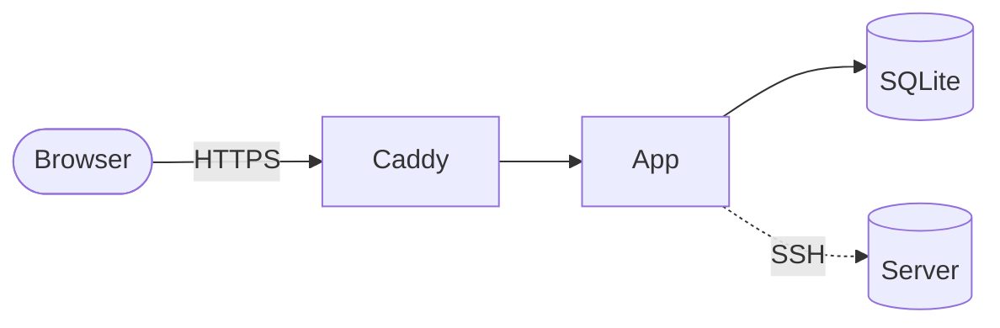

# Diagrams

A diagram earns its place when the answer is about **structure or movement**: how parts connect, the order things
happen in, what talks to what. If it's just a list, use a list.

## In the chat: a ```mermaid block (rendered automatically)
Use for quick structure while talking. Keep it to <= 12 nodes, short labels (2-4 words), one direction.

- `flowchart LR` for pipelines and architecture, `TD` for hierarchies and decisions.
- `sequenceDiagram` for who-calls-whom over time; `stateDiagram-v2` for states; `timeline` for dated events;
  `erDiagram` for data models; `gantt` for schedules; `pie` only for 2-5 parts of one whole.
- Shapes: `[box]` thing, `([pill])` person/start, `[(cylinder)]` storage, `{diamond}` decision, `((circle))` event.
- Group with `subgraph Name ... end`. Label edges only when the label adds information.
- Quote labels with punctuation: `a["Read (cached)"]`. No HTML, no styling, no emoji.

A small hand-made SVG also renders in the chat: a ```svg block containing one `<svg viewBox=...>...</svg>`
(no scripts). Use it when mermaid's layout can't show the idea (a cross-section, a labelled object, a curve).

## In an artifact: inline SVG with the kit's `.diagram` classes
Hand-place everything on a grid. It looks deliberate, and you control the story.
```html
<figure class="figure">
<svg class="diagram" viewBox="0 0 720 260" role="img" aria-labelledby="d-title">
  <title id="d-title">How a request reaches the app</title>
  <defs><marker id="arr" viewBox="0 0 10 10" refX="9" refY="5" markerWidth="7" markerHeight="7" orient="auto-start-reverse">
    <path d="M0 0L10 5L0 10z" fill="currentColor"/></marker></defs>
  <g style="color:var(--ink-2)">
    <rect class="node" x="20" y="100" width="150" height="60" rx="10"/>
    <text class="label" x="95" y="127" text-anchor="middle">Browser</text>
    <text class="sub" x="95" y="146" text-anchor="middle">your phone</text>
    <rect class="node accent" x="285" y="100" width="150" height="60" rx="10"/>
    <text class="label" x="360" y="135" text-anchor="middle">Caddy</text>
    <path class="edge accent flow" d="M170 130H285" marker-end="url(#arr)"/>
  </g>
</svg>
<figcaption>Every request passes through Caddy first, which adds HTTPS.</figcaption>
</figure>
```
**Layout rules**
- Pick a grid first: columns every 180-240px, rows every 100-120px. Node size consistent (e.g. 150 x 60, rx 10).
- Text centred in nodes: `x = node.x + width/2`, `y = node.y + height/2 + 5` (one line) or label at +27/sub at +46.
  Keep labels <= 16 characters per line; widen the node rather than shrink the font (min 12px).
- Edges: straight or right-angle paths (`M x y H x2 V y2`), ending at node borders, `marker-end` arrow. No diagonal
  spaghetti; no crossing lines if moving a node avoids it.
- Emphasis: one `accent` path or node (the thing the caption talks about). `dashed` for optional/async,
  `flow` (animated dashes) for live data only.
- Groups: a dashed `.group` rect behind related nodes with a small `.sub` label at its top-left.
- Always a `<title>` and a one-sentence `<figcaption>` that says what to notice.
- viewBox sized to the content plus 20px margin; the SVG scales to the column. Test the smallest width mentally:
  labels must stay readable at 360px (if not, stack vertically on mobile with a second SVG or a `TD` layout).

## Kinds and their shapes
- **Architecture**: left → right by request flow; storage at the bottom/right as cylinders.
- **Process / pipeline**: numbered steps left → right; decisions as diamonds with yes/no labels.
- **Cycle**: nodes on a circle, curved arrows (`A` arc paths), the loop's point in the centre.
- **Comparison**: two columns, same rows, differences highlighted with the accent.
- **Cross-section / anatomy**: the object drawn simply with `.node` shapes, leader lines to labels outside it.
- **Timeline**: use the kit's `.timeline` list, or a horizontal axis with ticks and dated markers.
